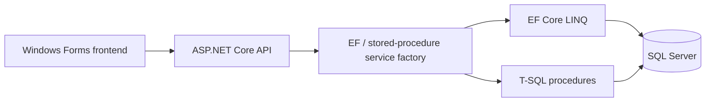

# CineLog — Social Movie Diary

A shared LUMS database course project by **Azaan Imran, Hanzalah Sohail Faraz, Muhammad Hashaam Tauseef and Raahem Azam** (Group 10). CineLog combines a SQL Server database, an ASP.NET Core API and a Windows Forms desktop frontend for movie discovery, reviews, watchlists, lists, social activity and analytics. Reports establish team membership; they do not establish an exact per-person division of implementation work.

## Project structure and course phases

| Directory | Contents and source decision |
|---|---|
| `course-deliverables/part-1/` | Original proposal and ER-diagram PDF |
| `course-deliverables/part-2/` | Original database implementation report; associated SQL is canonicalized under `database/` |
| `course-deliverables/part-3/` | Original SQL/application feature report |
| `backend/` | Canonical `Project/backend/Cinelog-DBProject`: ASP.NET Core API, business logic, EF Core data layer and EF/stored-procedure mode switching |
| `frontend/Phase3/` | Canonical `Project/Cinelog-DBProject/Phase3`: Windows Forms source, forms/resources and matching client DTOs/models |
| `database/` | Part 2 schema/import/seed/features, Part 3 additional procedures/indexes, extra-credit diagnostic SQL |
| `deployment/extra-credit/` | Kubernetes SQL Server deployment/service/PVC and original setup notes with password removed |
| `data/DriveLinkToCSV.md` | Original supplied movie-CSV acquisition link; access and redistribution rights not independently certified |

There are **three numbered course parts plus separately packaged extra credit**. The extra-credit text file internally calls itself “PHASE 4”; that heading is preserved as source evidence, not treated as proof of a fourth formal deliverable.

The top-level combined application tree and its copy in `Group10_P3` are identical. Its backend variant differs from the separate backend folder and lacks the same active runtime-switching wiring. The separate backend is used with the shared desktop client; duplicate copies, ZIPs, compiled binaries, `obj`, `.vs`, `.git`, macOS metadata and user-specific IDE files are omitted. Full archive inventories and per-file provenance are in repository `docs/`.



## Local setup

Prerequisites: Windows for the desktop UI, a compatible .NET SDK capable of building `net9.0` / `net9.0-windows`, and a **fresh isolated local SQL Server** instance. The project is an academic desktop application, not a React/web frontend.

1. Review [database setup](database/README.md), acquire the original cleaned movie CSV if authorized, and initialize the fresh database with SQLCMD. No database is automatically created or migrated by starting the API.
2. Set your own connection string in PowerShell; it is deliberately empty in tracked `appsettings.json`:

```powershell
$env:ConnectionStrings__DefaultConnection='Server=localhost,1433;Database=CineLog;User Id=YOUR_LOCAL_USER;Password=YOUR_LOCAL_PASSWORD;Encrypt=True;TrustServerCertificate=True'
dotnet restore backend/CineLogBackend.sln
dotnet build backend/CineLogBackend.sln --no-restore
dotnet run --project backend/CineLog.API --launch-profile http
```

The local HTTP profile uses `http://localhost:5285`; Swagger is at `/swagger`. `TrustServerCertificate=True` is only a local-demo example.

3. In a second terminal:

```powershell
$env:CINELOG_API_URL='http://localhost:5285/api/'
dotnet run --project frontend/Phase3/Phase3.csproj
```

Use a seeded numeric user ID in the login form. **This is a demo user selector, not password authentication.** The API has no production authorization boundary and should remain on a trusted local interface. EF/SP mode is global to the application, not isolated per user. Do not deploy this academic app as a public service without further work.

## Database and reported results

The original Part 2 report records 940,697 movies, 1,000,000 synthetic reviews, 1,000 users, 20 genres and 1,353,358 movie/genre mappings. These are historical report values, not row counts independently recreated here. The SQL source contains synthetic generation statements; no real-user database export is included. `movies.csv` (592,046,065 bytes) and `movies_cleaned.csv` (514,326,741 bytes) remain external. The schema's bulk import expects `movies_utf8.csv`; an exact cleaning/conversion script was not supplied, so end-to-end data preparation is not claimed reproducible from the raw CSV alone.

Features include partitioned reviews, views, indexes, triggers, stored procedures, recommendation/analytics queries and an EF-versus-SP implementation switch. The rating trigger processes only one affected movie from `inserted`/`deleted`, which limits correctness for multi-movie bulk changes. SQL routines and frontend/API behavior require database-backed verification before broader use.

See [verification](../../docs/VERIFICATION.md) for actual build/test outcomes and known limitations. Original course PDFs are retained; screenshots and performance measurements were not invented. No blanket license was present in the supplied project. Team code, third-party .NET packages, external movie data and SQL Server licensing have separate rights.
