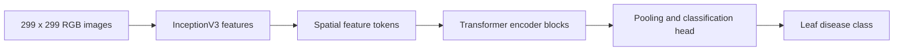

# Hybrid CNN–Transformer Plant Disease Classification

Research experiments combine an ImageNet-pretrained InceptionV3 feature extractor with Transformer encoder blocks for multi-class leaf-disease classification. Evaluation spans controlled leaf imagery and more challenging field-like imagery.

## Authors and source

The research report credits **Hanzalah Sohail Faraz, Azaan Imran, and Murtaza Taj**, Computer Vision and Graphics Lab, LUMS. Imported from [plant-disease-classifier](https://github.com/azaan-imran192/plant-disease-classifier/tree/a2146971953eaa87b345d1cb502d761f49a29b34); its [MIT license](LICENSE) is retained. This repository does not claim a peer-reviewed publication or sole authorship.

## Materials and technology

| Directory | Experiment |
|---|---|
| `plant_village/plantvillagehybrid.ipynb` | PlantVillage experiment |
| `cropped_plant_doc/croppedplantdochybrid.ipynb` | Cropped PlantDoc; includes exploratory CAI/K-CAI cells |
| `new_plant_disease/newplantdiseasehybrid.ipynb` | New Plant Diseases experiment |

The original [research report](Hybrid_CNN_Transformer_Approach_With_Transfer_Learning_for_Efficient_Multi_Plant_Disease_Detection.pdf) and saved notebook outputs are retained. Stack: Python, TensorFlow/Keras, NumPy, scikit-learn, OpenCV, Matplotlib, Seaborn, SciPy, and Jupyter. Notebook-specific package installation cells and Kaggle paths are preserved as historical experiment context.

## Reproduction procedure

1. Obtain the corresponding dataset under its own terms. The notebooks reference Kaggle input directories; map these to your authorized local/Kaggle dataset paths before execution.
2. Use a separate TensorFlow environment with GPU support if available. Install the libraries imported by the chosen notebook. The historical repository has no complete pinned environment, so an exact reproduction environment is not claimed.
3. Inspect each notebook's setup and training stages before running all cells. The Cropped PlantDoc notebook includes exploratory CAI imports and package-install cells; those require that separate dependency if executing the exploratory section.
4. Keep checkpoints outside ordinary Git. Model references, original paths, LFS object IDs, and byte sizes are recorded in [model-references.json](model-references.json). Retrieve authorized checkpoint objects from the source repository's LFS storage if needed; availability was not verified by downloading the binaries.
5. Load custom layers consistently when restoring Keras models, and evaluate on the intended held-out split.

## Reported results

| Dataset | Test accuracy reported in the research report |
|---|---:|
| PlantVillage | 99.57% |
| Cropped PlantDoc | 79.32% |
| New Plant Diseases | 98.70% |

These are **historical research results**, not fresh training runs. Saved outputs and source were inspected; expensive training, dataset licensing review for redistribution, GPU reproducibility, and checkpoint loading were not completed. No research image datasets or weights are republished here. The lower field-like dataset result illustrates a generalization gap; high controlled-dataset accuracy is not evidence of field reliability. See [verification](../../../docs/VERIFICATION.md).
