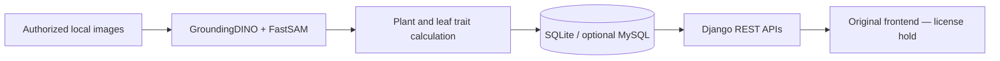

# Plant Phenotyping FYP Dashboard

A final-year-project application for organizing plant images, extracting plant/leaf traits, and presenting image-level and temporal measurements. The consolidated component contains the independently maintained Django backend. Its React frontend is withheld because the original includes **Creative Tim Otis Admin PRO** and public redistribution permission has not been established.

## Source and ownership

Recovered from [plant-phenotyping-dashboard](https://github.com/azaan-imran192/plant-phenotyping-dashboard/tree/edd9125a7411a22d95884c9a87f8002cadcf10f7). Azaan Imran maintains the source repository. Commit authorship alone does not establish sole ownership of the FYP; the full teammate/supervisor contribution statement remains to be supplied. GroundingDINO, FastSAM/Ultralytics, and the Otis template are third-party work and are not claimed as authored components.

## Architecture and stack

`backend/plants/` holds plant records and temporal summaries; `backend/traits/` provides image metadata, trait calculations, segmentation integration, serializers, routes, and management commands. `backend/config/` configures Django and the API prefixes.

Python, Django 5.2, Django REST Framework, SQLite, optional MySQL/PyMySQL, OpenCV, NumPy, Pillow, PyTorch/torchvision, GroundingDINO, and FastSAM. The original frontend uses React, Material UI, and Chart.js within the commercial template.



## Local backend setup

Use Python 3.12. From `backend/`:

```sh
python -m venv .venv
# Activate .venv.
python -m pip install -r requirements.txt
```

Set environment variables in your shell using `backend/.env.example` as a reference. `.env` files are **not** automatically loaded by this backend. For PowerShell:

```powershell
$env:DJANGO_SECRET_KEY = (python -c "import secrets; print(secrets.token_urlsafe(48))")
$env:DJANGO_DEBUG = 'true' # local development only; default is false
$env:DJANGO_ALLOWED_HOSTS = 'localhost,127.0.0.1'
$env:ENABLE_MYSQL = 'false'
python manage.py check
python manage.py migrate
python manage.py runserver 127.0.0.1:8000
```

The local default does not connect to an external research database. The imported source removes the unsupported MySQL-version-check bypass. If using MySQL, provision your own supported database, set `ENABLE_MYSQL=true` and the `MYSQL_*` variables, and inspect the unmanaged `plant_traits` schema before running any table-creation or push commands. Those commands were not run against a remote system.

Image APIs include `/api/images/`, `/api/images/<id>/traits/`, `/api/images/<id>/leaves/`, `/api/filters/`, and `/api/traits/temporal/`. Plant APIs include `/api/plant/<id>/dashboard/` and `/api/plant/<id>/temporal/`. Empty databases and absent images naturally provide no scientific results.

## Segmentation dependencies

The original integration expects `backend/third_party/GroundingDINO`, `backend/third_party/fastsam`, and `backend/third_party/weights/`. Third-party source trees and model weights are not vendored in this import. Follow the upstream [GroundingDINO](https://github.com/IDEA-Research/GroundingDINO) and [FastSAM](https://github.com/CASIA-IVA-Lab/FastSAM) installation instructions and license terms before installing separately. The audited source contains Apache-2.0 and AGPL-3.0 notices respectively; their terms do not become a blanket license for this repository. Expected checkpoints are `groundingdino_swint_ogc.pth` and `FastSAM-x.pt`. Downloads, CUDA compatibility, and model execution are unverified.

## Security and limitations

Hardcoded Django/database credentials were replaced by environment variables. Debug defaults off; external API host details were replaced with an explicit configurable placeholder. No SQLite database, captured image archive, uploaded media, third-party template, or weights are copied. Rotate any exposed credentials in the original source; changing a new copy does not remove them from history.

Trait scores are algorithmic proxies, including pixel-space measures; no validated physiological calibration or clinical/agronomic accuracy is claimed. Segmentation loads heavy model dependencies and checkpoints, and optional synchronization/export commands require independently configured external services. No end-to-end frontend, external-database, or segmentation test is claimed. See [verification](../../../docs/VERIFICATION.md) and [frontend status](frontend/README.md).
