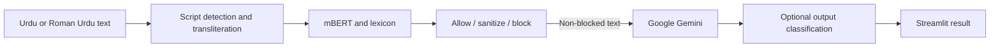

# Urdu / Roman Urdu LLM Safety Pipeline

An NLP course project by **Azaan Imran** and **Ahmad Bilal Habib ([ahmad4376](https://github.com/ahmad4376))**. It combines a fine-tuned multilingual BERT classifier, a RUHSOLD lexicon, rule-based transliteration/sanitization and Google Gemini in a Streamlit demonstration. This is an academic experiment; its moderation decisions are fallible and do not establish production readiness.

Source: [shared repository](https://github.com/ahmad4376/Urdu_toxic_prompt_filter/tree/ec6ee7a17e47105acce859c52d03a2a000353c86). All 51 ZIP members match that commit's Git blobs. Original reports use the shorter spelling “Ahmed Bilal”; this README uses the teammate's confirmed name. Individual contribution proportions are not inferred from commit counts.

## Structure and execution

| Location | Purpose |
|---|---|
| `src/toxic_filter.py` | mBERT inference, script detection, transliteration, fuzzy lexicon matching, attention/differential word attribution, allow/sanitize/block decisions |
| `src/llm_client.py` | Original Gemini integration with configurable API key/model and optional output checking |
| `demo/app.py` | Streamlit UI, threshold controls, examples and Gemini response generation |
| `notebooks/` | Six original EDA, baseline, transformer-training and pipeline notebooks, including both Gemini variants |
| `reports/` | Original saved evaluation/example CSVs |
| `deliverables/` | Proposal PDF, first deliverable report, final pipeline examples and documentation |
| `tests/` | Original interactive/model tests and consolidation verification |
| `lfs-resources.json` | 22 upstream LFS object IDs, sizes and availability probes |



Use Python 3.12 in a virtual environment. From this project directory:

```sh
python -m venv .venv
# Activate .venv for your shell, then:
python -m pip install -r requirements.txt -c constraints-tested.txt
```

Retrieve the model/lexicon using [RESOURCE-SETUP.md](docs/RESOURCE-SETUP.md) before importing `src.toxic_filter`: the recovered implementation loads resources at import time. Launch with:

```sh
python -m streamlit run demo/app.py
```

Supply **your own Google AI Studio API key** in the masked sidebar, `GOOGLE_API_KEY` environment variable, or `.streamlit/secrets.toml` (`GOOGLE_API_KEY = "your-own-key"`). `.env.example` is a reference template; it is not automatically loaded. Never commit either secret file. `GEMINI_MODEL` overrides the original `gemini-2.5-flash` default if that model is unavailable to your account. No paid/live Gemini request was made during consolidation. If the old academic demo key is still active, revoking or rotating it is sensible; its value is absent from this copy and the original repository was not modified.

Run eight offline decision/configuration tests with `python tests/test_offline.py` (mocked inference, not model quality). Run original model verification with `python tests/test_toxic_detection.py`. `python tests/test_llm_integration.py` is an interactive integration script that may call Gemini only when you provide your own key. These scripts print results rather than providing a comprehensive automated test suite.

For notebooks, start Jupyter from this directory and use each notebook's existing setup cells. Keep kernel working directories at `notebooks/`; the transformer notebook has environment-configurable corpus/output paths. See the resource guide. Saved outputs are historical and retained; executing all cells can retrain models or call Gemini.

## Recorded evaluation evidence

| Artifact | Recorded result | Interpretation |
|---|---|---|
| `1_data_exploration_and_baseline.ipynb`, original cell 12 | Combined-corpus TF-IDF baseline: accuracy 0.845, macro F1 0.801 on 16,991 examples | Consistent with first-deliverable report; not a rerun |
| `02_transformer_training_kaggle.ipynb`, original cell 8 | Test accuracy 0.9184, toxic-class F1 0.8204, macro F1 0.884 on 8,496 examples | Historical checkpoint evaluation; training not repeated |
| `3_toxicity_filter_demo.ipynb`, original cell 13 | Accuracy 0.383, macro F1 0.380 on 2,000 examples | A discrepant saved evaluation remains visible; it is not replaced by the better training score |
| `reports/` and final-deliverable CSV | Example decisions, probabilities, sanitization/LLM outputs | Demonstration evidence, not an independently labelled benchmark |

See the repository [verification record](../../docs/VERIFICATION.md) for actual consolidation checks. Transliteration loses linguistic information; corpus imbalance, source overlap, lexicon bias, threshold choice, attention interpretation and limited adversarial evaluation constrain conclusions. The current UI checks generated output for blocking but displays the original response for a `sanitize` decision; do not treat it as a guaranteed sanitized-output channel. `generate_safe` also treats non-blocked results as safe. These original behaviors are documented rather than silently changing research algorithms.

## Attribution and licensing

The source README labels the project MIT, but the inspected snapshot has no standalone license grant/copyright notice. That claim is recorded in [historical documentation](docs/UPSTREAM-README.md); no new blanket license is assigned. Model/base-model, RUHSOLD, RUT and Urdu YouTube corpus rights remain separate. Corpora and trained artifacts remain external with hashes and retrieval instructions; publicly accessible does not mean unrestricted redistribution. Toxic examples are research material and may contain offensive language. The source proposal describes an early pretrained-only plan; the final notebooks implement fine-tuning, so the proposal is not a specification of the final implementation.
