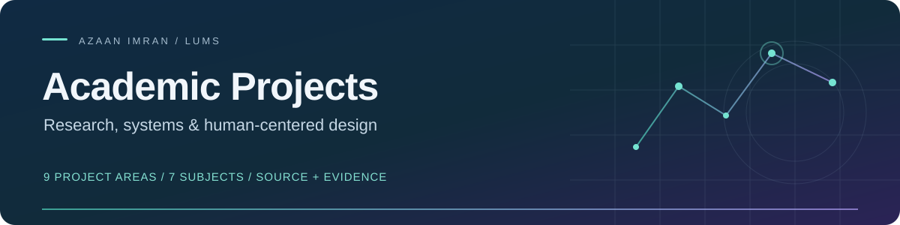
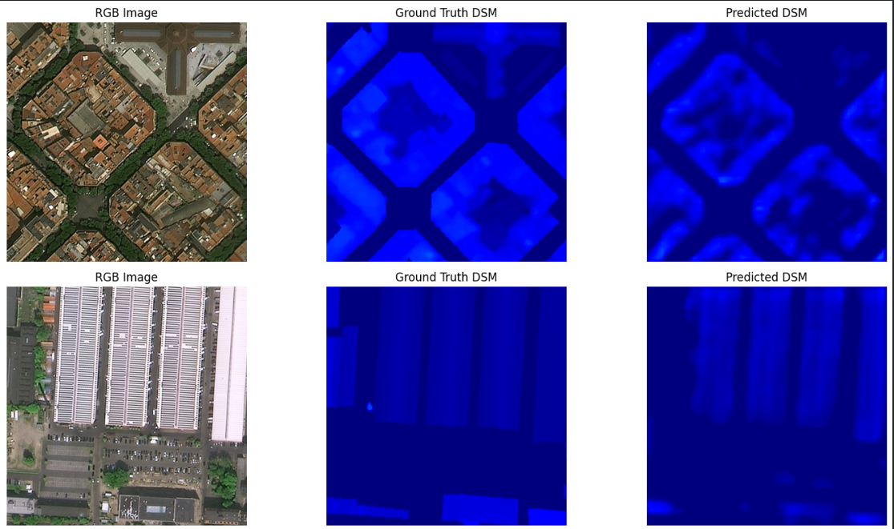

  

# Academic Projects

Academic and research work from my **BS Computer Science at Lahore University of Management Sciences (LUMS)**, spanning machine learning, computer vision, language technology, software systems and human-centered design.

This collection brings **nine project areas across seven subjects** into one repository. Each project includes its own source or design materials, setup guidance, evidence and attribution. Shared coursework is credited to its teams; reported research results are distinguished from checks reproduced during consolidation.

**Explore:** [Project directory](#project-directory) · [Result preview](#result-preview) · [Research and collaborators](#research-and-collaborators) · [Running the projects](#running-the-projects) · [Verification and availability](#verification-and-availability)

## Project directory

### Deep Learning & Computer Vision

Plant research is grouped under one [parent project](Deep-Learning-Computer-Vision/Plant-Research/), with separate classification and phenotyping components.

| Project | Work and evidence | Core technologies |
|---|---|---|
| [Building Height Estimation](Deep-Learning-Computer-Vision/Building-Height-Estimation/) | RGB/SAR height prediction on DFC2023. Eight notebooks preserve the baseline, two main improvements and alternative experiments. Improvement 2 records **6.8623 m RMSE / 3.4793 m MAE**; historical results, not a fresh training run. | Python · PyTorch · OpenCV · rasterio/GDAL |
| [Plant Disease Classification](Deep-Learning-Computer-Vision/Plant-Research/Disease-Classification/) | Hybrid InceptionV3–Transformer research across three leaf-image datasets. The report records **99.57% on PlantVillage and 79.32% on Cropped PlantDoc**, illustrating the controlled-to-field imagery gap. Training and checkpoint loading were not rerun. | TensorFlow/Keras · scikit-learn · OpenCV |
| [Plant Phenotyping FYP Dashboard](Deep-Learning-Computer-Vision/Plant-Research/Phenotyping-Dashboard/) | Django APIs for plant images, traits and temporal measurements, with segmentation integration. Local migrations and **six empty/missing-record API checks passed**. Authored backend available; commercial-template frontend held. | Django REST Framework · SQLite/MySQL · PyTorch · GroundingDINO/FastSAM |

### Natural Language Processing

| Project | Work and evidence | Core technologies |
|---|---|---|
| [Urdu / Roman Urdu LLM Safety](Natural-Language-Processing/Urdu-Roman-Urdu-LLM-Safety/) | mBERT, lexicon matching and transliteration route prompts through allow/sanitize/block decisions, with Gemini and Streamlit. **Eight offline tests**, an actual-model smoke test and Streamlit checks passed. Saved evaluations vary; the demo is not a production safety guarantee. | PyTorch · Hugging Face Transformers · Streamlit · Gemini |

### Machine Learning

| Project | Work and evidence | Core technologies |
|---|---|---|
| [Urdu News Classification](Machine-Learning/Urdu-News-Classification/) | Five-topic classification with custom Naive Bayes, logistic regression and a neural network. **97.92% Naive Bayes accuracy reproduced** on 289 held-out rows. Other workflows have documented vocabulary leakage; results remain coursework evidence. | Python · NumPy · pandas · scikit-learn · PyTorch |

### Data Science

| Project | Work and evidence | Core technologies |
|---|---|---|
| [Mobile Usage Analysis](Data-Science/Mobile-Usage-Analysis/) | Exploratory analysis of **202 student survey responses**, including bootstrap intervals, correlations and classifiers. All **56 code cells executed** and three classifier accuracies reproduced. Observational findings do not establish causation. | pandas · SciPy · statsmodels · scikit-learn · Seaborn |

### Software Engineering

| Project | Work and evidence | Core technologies |
|---|---|---|
| [Culinary Cloud](Software-Engineering/Culinary-Cloud/) | Shared recipe application with discovery, discussions, media and external-service integrations. **Frontend production build passed** (435 modules); backend syntax checked. Authenticated database/OAuth/media/AI flows still need end-to-end testing. | React · Vite · Tailwind CSS · Node.js · Express · MongoDB |

### Databases

| Project | Work and evidence | Core technologies |
|---|---|---|
| [CineLog](Databases/CineLog/) | Social movie diary with an ASP.NET API, Windows Forms client, EF/stored-procedure switch and SQL analytics. **Both applications compile; five local API checks passed.** Three course parts and Kubernetes extra credit are preserved. Database-backed/UI tests remain outstanding. | C# · .NET · EF Core · SQL Server · WinForms · Kubernetes |

### Human–Computer Interaction

| Project | Work and evidence | Tools and methods |
|---|---|---|
| [ParkinsonPal](Human-Computer-Interaction/ParkinsonPal/) | Accessibility-focused concept for people with Parkinson's and caregivers: research, questionnaires, prototypes and usability evaluation. **All 30 original files remain unchanged.** This is an HCI design/evaluation project, not a shipped mobile app. | Figma · interviews · prototyping · accessibility · usability testing |

## Result preview

**Building Height Estimation — original Improvement 2 output**

The saved comparison shows RGB imagery, ground-truth DSM and model predictions. Improvement 2 has better recorded delta scores than Improvement 1 but worse RMSE/MAE; see the [experiment-by-experiment evidence](Deep-Learning-Computer-Vision/Building-Height-Estimation/REPRODUCIBILITY.md). These are original outputs, not newly generated screenshots.

More preserved evidence: [baseline images](Deep-Learning-Computer-Vision/Building-Height-Estimation/Baseline_Outputs.png) · [Improvement 1 images](Deep-Learning-Computer-Vision/Building-Height-Estimation/Improvement_1_Outputs.png) · [NLP evaluations](Natural-Language-Processing/Urdu-Roman-Urdu-LLM-Safety/reports/) · [CineLog course reports](Databases/CineLog/course-deliverables/) · [ParkinsonPal design materials](Human-Computer-Interaction/ParkinsonPal/02-Desgin/)

## Research and collaborators

I contributed to these projects alongside classmates and research collaborators. Individual READMEs and original reports preserve detailed attribution; consolidation commits do not imply sole authorship.

| Work | Team / research credit |
|---|---|
| Plant disease research | Azaan Imran, Hanzalah Sohail Faraz and Murtaza Taj — Computer Vision and Graphics Lab, LUMS. No peer-reviewed publication claim is made here. |
| Building Height Estimation | Azaan Imran and Muhammad Ibrahim (Group 31); DFC2023 baseline and HGDNet references credited in the project. |
| Urdu / Roman Urdu LLM Safety | Azaan Imran and [Ahmad Bilal Habib](https://github.com/ahmad4376). |
| Urdu News Classification | Hanzalah Sohail Faraz, Azaan Imran, Basil Hassan and Mujeeb Asad. |
| CineLog | Azaan Imran, Hanzalah Sohail Faraz, Muhammad Hashaam Tauseef and Raahem Azam (Group 10). |
| ParkinsonPal | Azaan Imran, Hussain Sulaiman Zia, Muhammad Talha Muneer, Rumaan Mujtaba and Zainab Humayun (UXperts / Group 08). Original phase reports record individual contributions. |
| Culinary Cloud / Mobile Usage | Shared coursework recovered from [Hanzalah Sohail's project collection](https://github.com/HanzalahSohail/Projects); full rosters remain to be confirmed. Culinary source also credits Samad for chat-route integration. |
| Phenotyping FYP | Research context and third-party components are documented; the complete FYP teammate/supervisor contribution statement remains to be supplied. |

## Running the projects

Start with the relevant project README. These are independent coursework environments: use a separate virtual environment or application setup for each project.

- **Research notebooks:** dataset access, GPU/native dependencies and original checkpoints may be required. Large datasets and model binaries are kept outside ordinary Git; manifests and retrieval instructions identify what is available.
- **NLP demo:** seven inference resources were downloaded and checksum-verified locally. Use your own Google AI Studio key for Gemini; no key is bundled.
- **Applications:** Culinary Cloud requires independently configured services. CineLog requires Windows for its client and an isolated SQL Server instance; its setup refuses to reset an existing database.
- **HCI:** browse the original research, design and evaluation materials; there is no production application to install.

## Verification and availability

The [verification report](docs/VERIFICATION.md) separates executed checks, historical findings and unverified integrations. The [inventory](docs/INVENTORY.md), [source manifest](docs/import-manifest.json), [three-project manifest](docs/new-project-import-manifest.json) and [checklist](docs/CONSOLIDATION-CHECKLIST.md) record provenance and completion.

**Available:** the nine areas above, their legitimate source/design materials, reports and project-level instructions.

**Externally dependent or incomplete:** Otis Admin PRO frontend redistribution is on hold; FYP segmentation/data integration, live Gemini calls, full GPU benchmark reproduction, Culinary service integrations and CineLog database/UI execution remain unverified. See [remaining inputs](docs/LOCAL-FILES-NEEDED.md).

Security and licensing findings are maintained separately in the [security review](docs/SECURITY-REVIEW.md). Software, reports, datasets, model weights and third-party templates have separate rights; this collection does not assert a blanket license over all materials.
