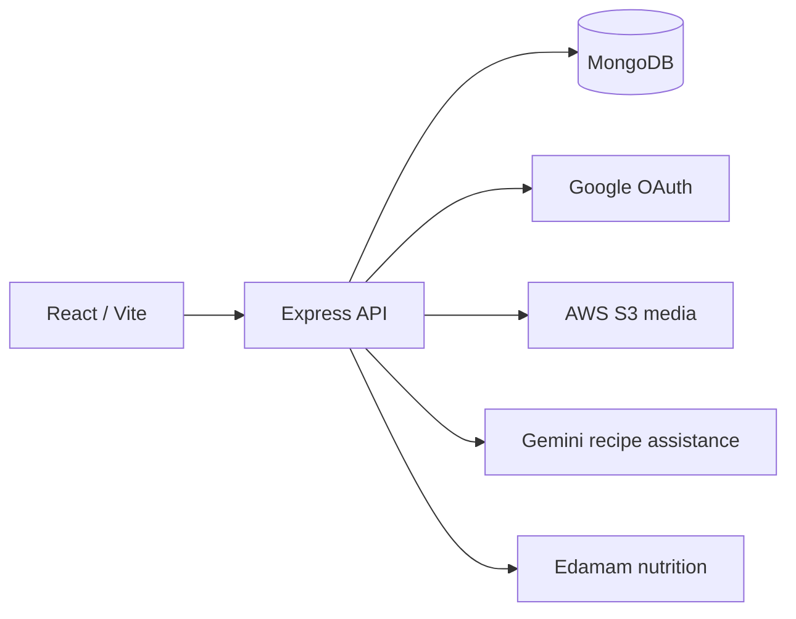

# Culinary Cloud

A shared software-engineering coursework application for creating, discovering, and discussing recipes. The recovered application has a React interface and an Express API with MongoDB persistence, authentication, media uploads, and optional recipe-assistance services.

## Provenance and contributions

Recovered from [HanzalahSohail/Projects](https://github.com/HanzalahSohail/Projects/tree/ded2c287a9a7f52b3c6fde837965b21a1d7c274c/CulinaryCloud_RecipeSharingPlatform). Azaan Imran identifies this as shared coursework with Hanzalah Sohail. Source comments also credit **Samad** for chat-route integration; the available files do not establish a full team roster or a reliable per-person division of work. Those details remain to be supplied. Do not interpret the single bulk-import commit as sole authorship.

Both original MIT copyright notices are retained in [LICENSE](LICENSE); merge-conflict separator lines were removed. Dependencies retain their respective licenses.

## Stack and architecture

- Frontend: React 19, Vite 6, React Router, Tailwind CSS, Axios.
- Backend: Node.js, Express 5, Mongoose, MongoDB, Passport Google OAuth, bcrypt, JWT, Express sessions.
- Integrations: AWS S3, Gemini, and Edamam. These need independently configured accounts; they were not contacted during verification.



`frontend/src/pages/` contains login/signup, recipe creation, browsing/search, recipe details, profiles, chat, and guided cooking. `Backend/routes/` exposes auth, recipe, comment, user, and chat routes; `Backend/models/` contains users, recipes, likes, comments, chat messages, and gamification logic.

## Local setup

Use Node.js 22 or a compatible maintained Node release and your own local MongoDB. From this directory:

```sh
npm ci --legacy-peer-deps
# Copy .env.example to .env and configure development credentials.
npm start
```

In a second terminal:

```sh
cd frontend
npm ci
# Copy .env.example to .env (VITE_API_URL=http://localhost:3000).
npm run dev
```

Open the local URL printed by Vite, normally `http://localhost:5173`. The API defaults to port 3000. Set distinct strong `JWT_SECRET` and `SESSION_SECRET` values. Google credentials are required by the current unconditional Passport strategy initialization, even if you only intend to test password login. Register the configured callback URL with your own OAuth application. AWS S3 is used by uploads; Gemini and Edamam are used by the associated recipe/chat endpoints. **Never put private API keys in `VITE_*` variables**, which are delivered to browsers.

The backend reads `.env` from this project directory because `npm start` launches `Backend/server.js` here. The AWS SDK dependency missing from the original manifest is added in this import. The legacy peer-dependency flag accommodates the recovered Cloudinary dependency combination; it is not evidence that those dependencies are current or vulnerability-free.

## Verification, results, and known limitations

See [verification](../../docs/VERIFICATION.md). Build and syntax checks do not establish working OAuth, database, S3, nutrition, or generative-AI integrations. No live service credentials were used, and no production deployment or measured usage outcome is claimed. No original project report or attributable live application screenshots were present in the selected shared folder.

The hardcoded fallback JWT signing secret was removed. The tracked frontend environment file, uploaded user images, generated Vite cache, and deployment-specific Fly configuration were excluded. The original source exposes an API key in its history: the owner of that key should rotate/revoke it and review usage. Existing session storage, OAuth token delivery, upload validation, dependency age, and error handling require additional review before deployment.
